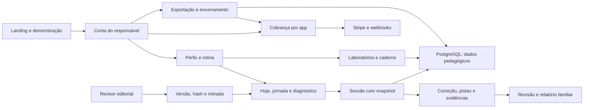

# Full review — Missão Saber

> Estado atual: as cinco pendências da revisão complementar foram corrigidas em [remediation-007.md](remediation-007.md), com parecer independente favorável. O texto abaixo preserva a evidência histórica desta revisão.

> Atualização: a [segunda revisão completa](full-review-2.md), feita posteriormente em 13/09/2026, confirmou cinco problemas novos pendentes em `reviews-007`. O parecer atual é corrigir antes de integrar; o texto abaixo preserva o resultado histórico da primeira revisão.

Data: 13/09/2026. Revisão independente do conjunto implementado, seguindo `cy-review-round`, com leitura do PRD/TechSpec, proposta, política autoral, relatórios e questões das fases anteriores. O revisor não alterou fontes da aplicação. Esta análise cobre o piloto implementado e suas integrações; não certifica aprendizagem, conformidade jurídica ou disponibilidade de serviços externos.

## Decisão integrada

**Clean — revisão concluída, sem achados remanescentes no piloto.** As duas questões novas de [reviews-006](../reviews-006/), uma alta e uma média, foram corrigidas e verificadas: faturas respeitam o app do cliente e a saída da conta permanece acessível após expirar a confirmação familiar. O resultado se refere aos achados da revisão; não declara que o check global do repositório esteja aprovado, nem que o produto já esteja publicado ou validado com estudantes.

As rodadas F1–F5 contêm dezesseis achados resolvidos. A revisão integrada acrescentou dois, também resolvidos, sem duplicar os anteriores: **18/18 questões corrigidas e verificadas**. O histórico completo permanece nos arquivos canônicos, com evidência de cada resolução. Não foram encontradas questões críticas.

## Escopo e mapa do sistema

Foram priorizados e lidos integralmente os fluxos novos de conteúdo, motor pedagógico, repositórios/transações, autorização, cobrança, privacidade, editorial e fronteiras HTTP. Os demais componentes, testes, estilos, configuração e documentação foram conferidos quanto à integração e inconsistências observáveis. A revisão inclui imports e contratos dos packages compartilhados, não apenas os arquivos do novo app.



O app não importa módulos de Agenda ou Cozya. A conta Informach é compartilhada; perfis e evidências pedagógicas ficam no schema próprio. Conteúdo oficial baixado está fora do bundle e não é fonte de execução. A biblioteca autoral é versionada em código; publicação depende de revisão explicitamente registrada para o conteúdo corrente. Migrações e configuração cadastram o produto sem executar implantação em produção.

## Confronto com os sete critérios do PRD

| Critério | Implementação e evidência | Limite material |
| --- | --- | --- |
| App independente, responsável, perfis e PostgreSQL | App na porta 3005, auth compartilhada, perfis subordinados, migrações próprias; isolamento testado com dois responsáveis. | Supervisão e verificação de responsabilidade precisam da validação da operação antes da venda pública. |
| Catálogo autoral 6º/7º e quatro trilhas | 24 missões, 144 atividades, 12 habilidades e 288 devolutivas; OLITEF N1, OBMEP N1, Canguru E/B por ano compatível. | São fundamentos compartilhados; não quatro bancos independentes nem cobertura integral das provas. Revisão humana pendente. |
| Missões, diagnóstico, domínio, revisão e retomada | Correção no servidor, snapshots, UUID idempotente, ordem e pistas persistidas, diagnóstico sem domínio, recomendação e calendário 1/3/7/14/30. | Modelo inicial de regras, ainda sem calibração empírica e sem demonstrar retenção/transferência com estudantes. |
| Áreas do aluno e três ferramentas acessíveis | Hoje, jornada, laboratório, revisão, simulados e caderno; controles por teclado, texto alternativo, retomada de malha, UI móvel. | Simulados são formativos; não reproduzem pontuação, duração ou edição oficial. Acessibilidade técnica observada não equivale a auditoria completa com tecnologia assistiva. |
| Assinaturas, unidade gratuita e histórico preservado | Produtos/preços esperados, checkout/portal, entitlement por app, webhook isolado, fechamento remoto e exportação após perda de acesso. | Configuração Stripe/Portal real e homologação externa pendentes. |
| Família, privacidade e editorial | Rotina, evidências por perfil, consentimento versionado, exportação/limpeza, aprovação por hash, retirada e fila de relatos; saída sem reautenticação verificada. | Backups, suporte, reembolso e revisão jurídica são tarefas externas. |
| Testes, build, reviews e operação local | Unidades, integração descartável, E2E desktop/mobile, build e documentação presentes; reviews por fase e final registrados, verificações finais informadas abaixo. | Check global do repositório tem falhas legadas/artefatos; verificação focada passa. |

## Relação com a proposta ampliada

O resultado concretiza a fase de piloto de 120–180 atividades descrita na proposta. Entrega a rotina acessível, explicação específica de erro, primeiras decisões por habilidade, experimentação visual e acompanhamento familiar. O conteúdo é criado a partir de competências; não há importação de provas ou simples alteração de nomes e valores no código publicado. A originalidade e os gabaritos ainda exigem conferência humana independente antes de aprovar as aulas comerciais.

A proposta completa é maior que este piloto. Permanecem próximos passos: aproximadamente 600 atividades de lançamento; avaliações reservadas inéditas e evidência de transferência; missões com respostas numéricas, completar/ordenar etapas e justificativas integradas; sequência explícita de pré-requisitos e intervenção após erros recorrentes; simulados por edição com regras específicas, incluindo penalização Canguru e preparação discursiva OBMEP; importação revisada de progresso do legado. O desafio aprofundado atual usa malha, rubrica e caderno, com autorreflexão, e não oferece correção humana ou automática de texto livre.

Também permanecem futuras a expansão de anos/níveis, escolas e turmas, integração autorizada com Agenda da Turma, offline e tutor de IA. Esses itens não devem aparecer no relatório de entrega como funcionalidades concluídas. As medidas comerciais da proposta — ativação, retenção, pagamento, compreensão do relatório e melhora em problemas novos — exigem o piloto acompanhado; contagem de atividades e testes de software não as validam.

## Avaliação técnica transversal

| Área | Conclusão da revisão |
| --- | --- |
| Segurança | Autenticação nas actions, propriedade no repositório, sessão recente em dados familiares e compra, payloads limitados, assinaturas antes de processar webhooks, DTO sem gabarito antecipado; escopo das faturas corrigido e verificado entre apps. |
| Correção | Conteúdo, feedback, regras de recomendação, matemática das ferramentas e embargo de avaliações revalidados. Hash liga aprovação ao conteúdo exato; retirada bloqueia novos inícios. |
| Concorrência | Criação de perfil, tentativas, pistas e limpeza serializadas; publicação/início compartilham locks ordenados; experimentos detectam versões concorrentes; billing tem pool próprio de coordenação. |
| Desempenho | Adequado ao catálogo piloto. Histórico de evidências e mapa de releases ainda são leituras amplas; dimensionar com uso real. Jobs têm lotes fixos e exigem acompanhamento de backlog. |
| Erros | Actions retornam códigos e referências sem expor mensagens internas; dados são preservados quando encerramento remoto não conclui. Dunning distingue erro/deferimento de supressão e envio. |
| Qualidade | Domínio separado de páginas/actions, tipos e validação, compartilhamento por packages e scripts locais reproduzíveis. Alterações em billing são adicionais/opt-in salvo correções de contratos explícitos. |
| Testes | PostgreSQL real para regras de persistência, provider controlado para efeitos pagos, ECDSA real no SendGrid, E2E com usuário/OTP e UI real. Não são testes de aprendizagem nem homologação com serviços reais. |
| Arquitetura | App e schema próprios, catálogo comercial separado do acervo, conta compartilhada e cobrança identificada por app. Fatura recebida em endpoint estrangeiro revelou uma lacuna compartilhada que foi corrigida no lookup e na recuperação. |
| Operação | Preview isolado pronto, roteiro de homologação/produção, healthcheck, cron, revisão editorial e conexão por processo documentados. Deploy, alertas, preços, e-mails e aprovações não foram ativados. |

## Verificação e inspeção visual

Execução independente final do revisor em 13/09/2026 às 11:52:34 America/Sao_Paulo: `pnpm --filter @informach/missao-saber test:integration` aprovou **15 testes em dois arquivos**, exit 0; banco criado para a execução e removido ao final. Inclui doze responsáveis simultâneos com consultas reais dentro da coordenação e as duas direções do isolamento de faturas entre apps. Fixtures editoriais são removidas por suíte, evitando dependência da ordem dos arquivos. As fases anteriores contêm as demais evidências executadas pelo revisor.

```text
VERIFICATION REPORT
-------------------
Claim: Integração final e regressão de isolamento entre apps passam após as correções.
Command: pnpm --filter @informach/missao-saber test:integration
Executed: 2026-09-13 11:52:34 America/Sao_Paulo
Exit code: 0
Output summary: Test Files 2 passed (2); Tests 15 passed (15); banco descartável removido.
Warnings: notices de migrations legadas sobre extensões existentes e nome de FK truncado.
Errors: none
Verdict: PASS
```

Execuções finais informadas pelo implementador: **31 testes do app**, **188 de billing** (reexecutados após o isolamento de faturas), **216 de auth**, **505 de Agenda**, demais packages da execução Turbo; typecheck do workspace **12/12** reexecutado e build de produção após as correções aprovados. Três tarefas da execução ampla de testes usaram cache. O E2E aprovou seis cenários desktop/mobile, incluindo sessão envelhecida, área/exportação bloqueadas e saída da conta; o revisor conferiu fonte dos testes e `.last-run.json` com `passed` e nenhuma falha. Check focado final em **109 arquivos** informado com exit 0. Preview em porta 3005 responde 200 para `/` e `/api/health`, conforme verificação do implementador.

Inspeção independente de screenshots produzidos pelo E2E: Hoje móvel, missão desktop e laboratório móvel. A hierarquia, dimensões de controles, representação das barras, malha, estados salvos e conteúdo do desafio são coerentes e legíveis nas imagens; não foi observado conteúdo sobreposto ou corte horizontal da página. A navegação móvel usa rolagem horizontal própria. A imagem não substitui navegação assistiva; o E2E cobre controles por teclado e mede a proporção das barras.

**O lint integral não passou:** `pnpm check` reportou 4.209 erros e 1.971 avisos no repositório amplo, incluindo artefatos de pesquisa e formatação existente. O check focado final informado em 109 arquivos novos/alterados passou. Não foi realizada uma limpeza em massa fora do escopo, e o relatório de entrega deve preservar essa distinção.

## Condições para abrir o piloto pago

Obter revisão humana das aulas e publicar apenas as aprovadas; homologar cobrança/e-mail com os provedores; definir atendimento, privacidade, retenção, reembolso e responsabilidade; configurar operação/alertas; realizar o piloto com famílias antes de afirmar eficácia ou expandir o catálogo. Os achados de código desta revisão estão encerrados e há verificações técnicas finais, mas isso não demonstra que essas etapas externas ocorreram.
