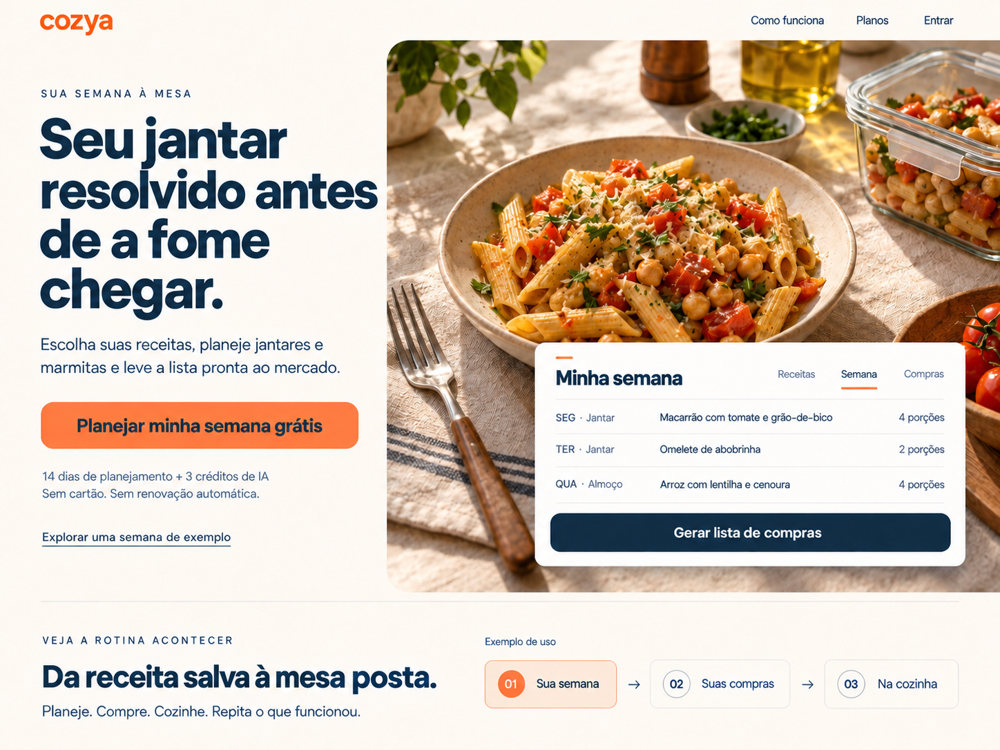

# Cozya — proposta da página inicial e de vendas

11 de setembro de 2026 · Proposta de narrativa, copy e direção visual aprovada pelo usuário e implementada no aplicativo. Veja o [registro da implementação e verificação](./implementacao.md).

Conceito visual criado com geração de imagens integrada. Texto e especificação de comportamento abaixo são a referência para implementação. [Registro dos prompts](./prompt-visual.md).

## 1. A ideia que organiza a página

**Seu jantar resolvido antes de a fome chegar.**

O Cozya ajuda quem cozinha em casa a transformar suas próprias receitas em uma semana de refeições, compras e preparos organizados. A página deve fazer a pessoa imaginar uma cena específica: chegar ao fim do dia, abrir o celular e encontrar o jantar escolhido, os ingredientes na lista e o preparo à mão.

O público principal é quem organiza a alimentação de uma casa de duas a quatro pessoas e também prepara marmitas. O desejo é ter menos decisões acumuladas no fim do dia e conseguir repetir uma rotina que funciona. A promessa precisa aparecer acompanhada do mecanismo: **receitas → semana e porções → compras → preparo → repetir**.

A IA entra como ajuda para montar e adaptar o acervo. O valor recorrente da assinatura aparece no uso desse acervo durante a semana.

### O que a página atual precisa mudar

| Elemento atual | Proposta |
| --- | --- |
| Hero menciona a semana, mas destaca cartões de receitas e chips Foto/Voz/Prompt | Mostrar um prato apetitoso junto de uma semana planejada, com porções e acesso às compras |
| A primeira demonstração é de captura com IA | Demonstrar planejamento, lista e preparo com o mesmo conjunto de receitas |
| “Como funciona” ainda é Capture / Revise / Cozinhe | Tornar visível o caminho completo, incluindo compras, marmitas e repetição |
| Várias seções de cartões e listas de funcionalidades | Alternar uma demonstração ampla, cenas de uso, fotografia e blocos curtos de copy |
| Preço anual enfatiza o equivalente mensal | Destacar R$ 149/ano e explicar o equivalente mensal em segundo plano |
| Título de busca e compartilhamento ainda promete “receita por voz, foto ou prompt” | Alinhar título, descrição e imagem social ao planejamento da rotina |

## 2. A página, com a copy proposta

### 1 — Primeira dobra: desejo, utilidade e convite

**Navegação:** Como funciona · Planos · Entrar. Marca Cozya à esquerda; navegação discreta para preservar a força do convite principal.

**Linha de apoio**

> SUA SEMANA À MESA

**Título principal**

> Seu jantar resolvido antes de a fome chegar.

**Texto**

> Escolha suas receitas, planeje jantares e marmitas e leve a lista pronta ao mercado. O Cozya organiza o caminho até a mesa.

**Botão principal:** Planejar minha semana grátis

**Texto junto ao botão**

> 14 dias de planejamento + 3 créditos de IA. Sem cartão. Sem renovação automática.

**Link secundário, com menos destaque:** Explorar uma semana de exemplo

**Visual:** fotografia de comida cotidiana bem preparada, com luz natural, louça de cerâmica e uma marmita ao lado. Sobre parte da fotografia, um painel legível da semana com três refeições e o botão “Gerar lista de compras”. A imagem desperta vontade de comer; a interface mostra como o app participa dessa rotina.

O botão principal leva ao cadastro gratuito. Depois da verificação do e-mail, a pessoa ativa o teste explicitamente. A jornada precisa manter essa sequência clara, com o planejamento como próximo objetivo.

### 2 — Demonstração: sentir a utilidade antes do cadastro

**Título**

> Da receita salva à mesa posta.

**Texto**

> Comece com três refeições. Escolha os dias, ajuste as porções e gere as compras. Na hora de cozinhar, acompanhe cada etapa.

Uma demonstração interativa, identificada como **“Exemplo de uso”**, ocupa o centro da página. Três abas grandes apresentam a mesma história:

| Aba | O que a pessoa faz | O que percebe |
| --- | --- | --- |
| Sua semana | Abre uma refeição e troca de duas para quatro porções | O planejamento comporta o jantar e porções extras |
| Suas compras | Gera a lista e marca um ingrediente como “Já tenho” | As escolhas viram uma lista que pode ser conferida antes do mercado |
| Na cozinha | Abre a receita e marca uma etapa concluída | O Cozya acompanha também a execução |

**Legendas curtas:** “Escolha o que vai à mesa.” · “Leve as escolhas para a lista.” · “Acompanhe o preparo.”

O exemplo usa dados locais e controles reais da demonstração, sem cadastro ou consumo de IA. Um botão “Recomeçar exemplo” permite explorar novamente. Quem não interage ainda deve compreender o benefício pela imagem inicial e pelas legendas.

### 3 — A cena que aproxima o produto da vida real

**Título**

> Jantar de hoje. Marmita de amanhã.

**Texto**

> Vai cozinhar para dois e separar duas marmitas? Planeje quatro porções. O Cozya ajusta as quantidades calculáveis da receita e leva os ingredientes para a lista de compras.

**Fecho**

> Uma decisão de hoje pode deixar outra refeição encaminhada.

**Visual:** composição editorial com dois pratos e dois recipientes, junto de um recorte da seleção de porções. Uma anotação curta explica: “2 para o jantar + 2 para levar = 4 porções”.

Essa seção vende um uso concreto. Na demonstração, as porções extras pertencem ao preparo original: uma anotação da marmita no dia seguinte não deve somar os mesmos ingredientes novamente. O app não faz essa dedução automaticamente.

### 4 — As receitas da pessoa viram o ponto de partida

**Título**

> Suas receitas favoritas, prontas para entrar na semana.

**Texto**

> A receita do caderno, o print guardado no celular, aquele preparo que você sabe de cabeça. Reúna tudo no Cozya para encontrar, planejar e cozinhar de novo.

**Demonstração visual:** uma receita de exemplo passa de foto ou texto para uma ficha organizada. A sequência termina em “Revisar e salvar”, deixando visível a participação da pessoa.

**Legendas:** “Fotografe uma receita.” · “Cole o texto ou conte por voz.” · “Revise e guarde no seu acervo.”

**Complemento**

> A IA ajuda a organizar, pesquisar e adaptar receitas. Você também pode cadastrar tudo manualmente.

Aqui os recursos de IA ganham contexto e relevância. Evitar um carrossel extenso de modalidades ou uma segunda grade de benefícios repetidos.

### 5 — O motivo para continuar usando e pagar

**Título**

> Uma semana que funciona merece se repetir.

**Texto**

> Reaproveite as refeições da semana anterior, troque o que quiser e atualize a lista. Suas receitas favoritas continuam à mão para a próxima rodada.

**Linha de valor**

> Seu acervo ganha uso. Seu planejamento ganha continuidade.

**Visual:** duas semanas lado a lado, com a ação “Repetir semana anterior” e uma refeição sendo trocada. No celular, mostrar uma semana por vez, com um controle explícito de avançar.

**Chamada curta**

> Planejar, ajustar porções e acompanhar o preparo não consome créditos de IA.

O recurso de repetição preenche horários vazios a partir da semana anterior e preserva refeições já preenchidas. A demonstração deve representar esse comportamento.

### 6 — Oferta: experimentar na própria rotina

**Título**

> Experimente na sua semana. Continue com o que faz sentido para você.

**Faixa de entrada gratuita**

> Crie sua conta e, depois de verificar o e-mail, ative 14 dias de planejamento e 3 créditos de IA para experimentar. Sem cartão e sem assinatura automática.

**Botão:** Planejar minha semana grátis

Logo abaixo, duas opções de Cozya Pro. Os recursos são os mesmos; muda o ciclo de cobrança.

| | Mensal | Anual |
| --- | --- | --- |
| Nome | Cozya Pro mensal | Cozya Pro anual |
| Preço principal | **R$ 14,90/mês** | **R$ 149/ano** |
| Explicação | Cobrado mensalmente | Cobrado anualmente; equivalente a aproximadamente R$ 12,42/mês |
| Destaque | Flexibilidade para sua rotina | Melhor valor no ano |
| Economia comparativa | — | R$ 29,80 em relação a 12 mensalidades; aproximadamente 17% |
| Botão | Assinar mensal | Assinar anual |

**Incluído nos dois planos:** planejamento semanal com porções; listas de compras; repetição da semana; receitas ilimitadas; captura, pesquisa e adaptação com IA; **50 créditos de IA renovados a cada mês**, inclusive no plano anual.

**Nota sobre uso**

> Cada tarefa concluída de IA usa 1 crédito. O cadastro manual, o planejamento e o preparo não consomem esses créditos.

**Alternativa gratuita, em bloco secundário legível**

> Prefere começar pelo seu caderno de receitas? O Free permite cadastrar até 15 receitas. Ao terminar o teste, seu acervo, o modo de preparo e as listas já criadas continuam acessíveis. Para fazer novos planejamentos, escolha o Pro.

O limite gratuito restringe novos cadastros; receitas já existentes acima desse limite não são apagadas. O selo anual indica uma vantagem matemática, sem alegar que ele é o plano mais escolhido.

### 7 — Perguntas que ajudam a decidir

**Preciso ter uma semana inteira planejada para começar?**

> Você pode começar com uma receita e três refeições. Acrescente outras escolhas conforme sua rotina.

**Preciso de cartão para experimentar?**

> Não. Após verificar seu e-mail, ative um teste de 14 dias de planejamento, com 3 créditos de IA para todo o período. O teste é oferecido uma vez e não vira uma assinatura automaticamente.

**O que acontece quando o teste termina?**

> Seus dados continuam na conta. Você pode consultar seu acervo, usar o modo de preparo e acessar as listas já criadas. O Free permite novos cadastros dentro do limite de 15 receitas. Novos planejamentos e o uso de IA ficam disponíveis com o Pro.

**A lista sabe o que já tenho em casa?**

> Você marca os itens que já tem. O Cozya reúne ingredientes compatíveis das receitas planejadas; algumas medidas precisam de conferência. Depois de mudar refeições ou receitas, use a ação de atualizar a lista.

**A IA é obrigatória?**

> Você pode cadastrar receitas manualmente. A IA ajuda quando quiser organizar uma foto, texto ou áudio, pesquisar uma receita ou fazer uma adaptação. Revise o resultado antes de salvar.

**E se os 50 créditos do mês acabarem?**

> Você continua com suas receitas, planejamento, compras e preparo. Os recursos de IA aguardam a renovação mensal ou a compra de créditos extras enquanto seu Pro estiver ativo.

**Posso usar no celular?**

> Sim. O Cozya funciona no navegador do celular e do computador, com conexão à internet. Em aparelhos compatíveis, você pode adicioná-lo à tela inicial.

**Posso cancelar a assinatura?**

> Você pode cancelar a renovação pela sua conta. O Pro continua disponível até o fim do período já pago; depois, a conta volta ao Free e seu acervo continua acessível.

### 8 — Convite final

**Título**

> Deixe os próximos jantares encaminhados.

**Texto**

> Escolha uma receita que você gosta. Monte suas primeiras refeições. Leve a lista com você.

**Botão:** Planejar minha semana grátis

**Apoio:** 14 dias de planejamento + 3 créditos de IA. Sem cartão. Sem renovação automática.

**Rodapé:** marca, uma frase curta sobre o produto, suporte, termos e privacidade. Links de suporte devem usar os canais já existentes.

## 3. Direção visual

**Clima:** mesa de casa bem cuidada, comida de verdade e software fácil de entender. A composição aproxima o produto de uma revista de gastronomia contemporânea, com uma interface que participa da história.

| Elemento | Direção |
| --- | --- |
| Fundo | Creme quente `#FFF8EE`, alternando com branco nas demonstrações |
| Texto | Azul-marinho da marca `#173247` |
| Ação principal | Laranja Cozya `#FF7A3D`, com texto marinho |
| Cor auxiliar | Verde discreto para estados e marcações, acompanhado de texto ou ícone |
| Tipografia | Plus Jakarta Sans, já usada pelo produto; títulos grandes, pesos contrastantes, parágrafos curtos |
| Fotografia | Pratos cotidianos, ingredientes reconhecíveis, luz natural, louça e tecidos com textura |
| Interface | Recortes grandes de semana, compras e preparo; dados coerentes e rótulos legíveis |
| Composição | Alternância de fotografia ampla, demonstração horizontal e texto editorial; cartões concentrados onde ajudam a comparar |
| Movimento | Transições curtas após uma ação, mostrando a passagem de uma escolha para a próxima etapa |

O conceito visual da primeira dobra é uma referência de composição. Na implementação, o texto deve ser HTML e a interface deve usar componentes reais ou capturas verificadas. A fotografia é uma peça editorial, não uma fotografia de resultado culinário validado nem uma funcionalidade de geração de fotos do app.

### Celular

O título e o CTA aparecem antes da imagem. Texto entre 16 e 18 px e controles com área de toque de pelo menos 44 px. A demonstração ocupa a largura útil da tela, com uma etapa por vez. Uma barra discreta de convite pode aparecer depois que o CTA inicial sair da tela, sem encobrir controles, FAQ ou rodapé. Validar o comportamento em telas pequenas antes de adotá-la.

### Movimento, acesso e carregamento

O visitante controla a demonstração; não é necessário assistir a um vídeo para entender o produto. Se houver uma gravação complementar, oferecer reprodução voluntária, legendas e imagem de capa. Respeitar redução de movimento, teclado, foco visível e contraste. Carregar imagens no tamanho necessário, reservar seu espaço e adiar mídia abaixo da primeira dobra. A página deve continuar informativa sem a demonstração interativa carregada.

## 4. Especificação da demonstração

A interação pública é uma **nova peça de marketing proposta**, apoiada em recursos que já existem no aplicativo. Não representa uma funcionalidade já publicada.

Usar uma semana curta com receitas do acervo de exemplo. Para tornar o ajuste verificável, a Omelete de abobrinha tem rendimento original de duas porções, quatro ovos e uma abobrinha pequena. Ao escolher quatro porções, o exemplo deve mostrar oito ovos e duas abobrinhas pequenas.

1. Abrir a refeição e alterar as porções.
2. Acionar “Gerar lista de compras”; mostrar a consequência na lista.
3. Marcar um ingrediente como “Já tenho”.
4. Abrir o preparo e concluir uma etapa.
5. Apresentar o convite para fazer isso com as próprias receitas.

Ao alterar o planejamento depois de gerar compras, representar a ação de atualização que o app exige. Não simular sincronização automática inexistente. Usar medidas simples e compatíveis; itens “a gosto” permanecem como texto. Os únicos horários do planejamento atual são Almoço e Jantar; “marmita” é um contexto de uso, não um terceiro tipo de horário.

Os exemplos são demonstrativos. As receitas da coleção inicial ainda não passaram por teste culinário humano; não usar selos como “testadas e aprovadas”. Para capturas finais de produto, preparar dados editoriais e remover nomes, mensagens ou indicadores de testes técnicos.

## 5. Por que essa abordagem pode converter

As hipóteses de persuasão são específicas e devem ser verificadas com pessoas reais:

- **Reconhecimento:** “antes de a fome chegar” situa o benefício no momento em que decidir costuma pesar.
- **Antecipação da experiência:** a sequência jantar, mercado e marmita ajuda a pessoa a imaginar o app dentro da semana.
- **Prova pelo mecanismo:** mudar porções e observar a lista dá uma evidência concreta do que a assinatura entrega.
- **Pequeno primeiro compromisso:** experimentar três refeições parece viável para quem ainda não tem o hábito de planejar.
- **Redução de incerteza:** condições do teste, cobrança e permanência do acervo aparecem junto das decisões relevantes.
- **Motivo para voltar:** repetir e ajustar a semana torna visível a utilidade recorrente do Pro.

Como ainda não existem clientes pagantes, a prova central será o produto em uso. Relatos e resultados quantitativos podem entrar depois do piloto, com autorização e contexto. Nesta versão, demonstrações substituem espaços normalmente ocupados por depoimentos.

Não acrescentar promessas de tempo ou dinheiro economizado sem medição, receitas para condições clínicas, planejamento automático com IA, colaboração entre contas, importação universal de vídeos e links, funcionamento offline ou alarmes garantidos com o app fechado. Essas expectativas não correspondem ao escopo atual.

## 6. Busca, compartilhamento e validação

**Título para busca:** Cozya — planeje refeições, marmitas e compras

**Descrição:** Organize suas receitas, planeje jantares e marmitas e gere a lista de compras. Experimente 14 dias de planejamento, sem cartão.

**Imagem de compartilhamento:** frase “Sua semana à mesa”, fotografia editorial e um recorte legível do planejamento. A apresentação compartilhada deve comunicar o mesmo produto que a pessoa encontra na página.

### Validação inicial

Com cinco a oito pessoas do público principal, observar se conseguem explicar o produto depois de ver a primeira dobra; compreender a diferença entre teste, Free e Pro; usar o exemplo de porções e compras; e localizar o próximo passo para começar. São sessões qualitativas para identificar obstáculos, sem tratar essa amostra como comprovação estatística de conversão.

Depois, acompanhar o caminho completo: visita → interação com a demonstração → cadastro verificado → teste ativado → três refeições planejadas → lista gerada → preparo concluído → retorno na semana seguinte → assinatura. Comparar conversão também por origem de tráfego e dispositivo.

A hipótese principal é aumentar a proporção de visitantes que chegam a uma primeira semana útil e voltam. Cliques no botão são um indicador intermediário. Testes A/B de título ou demonstração fazem sentido quando houver tráfego suficiente; o preço permanece o definido pelo usuário.

### Entrega de implementação sugerida

1. Construir a nova narrativa, a oferta e o visual responsivo; atualizar metadados e compartilhamento.
2. Implementar a demonstração local com os estados e contas descritos neste documento.
3. Conferir as promessas contra os fluxos reais; verificar acessibilidade, carregamento e percurso do cadastro ao teste.
4. Colher as primeiras sessões de uso e ajustar os pontos de incompreensão antes de ampliar aquisição.

## 7. Referências e fundamento

O posicionamento considera a leitura do código atual do Cozya, especialmente a home, as seções de marketing, o conteúdo de planos, o acesso ao teste e as telas de semana, compras e preparo.

O [Plan to Eat](https://www.plantoeat.com/) apresenta escolha de refeições e lista de compras como benefício central. O [Crouton](https://crouton.app/) conecta organização pessoal de receitas, planejamento e preparo. O [CookBook](https://cookbookmanager.com/) usa a captura de receitas como entrada para organizar, planejar, comprar e cozinhar. Referências consultadas em 11/09/2026.

Minha leitura dessas referências é que a sequência semanal já é uma categoria compreensível. Para o Cozya, a oportunidade está em demonstrá-la com a linguagem da rotina brasileira, das próprias receitas e das marmitas. As referências orientam clareza e apresentação; números, depoimentos e funcionalidades de terceiros não são evidências sobre o Cozya.
