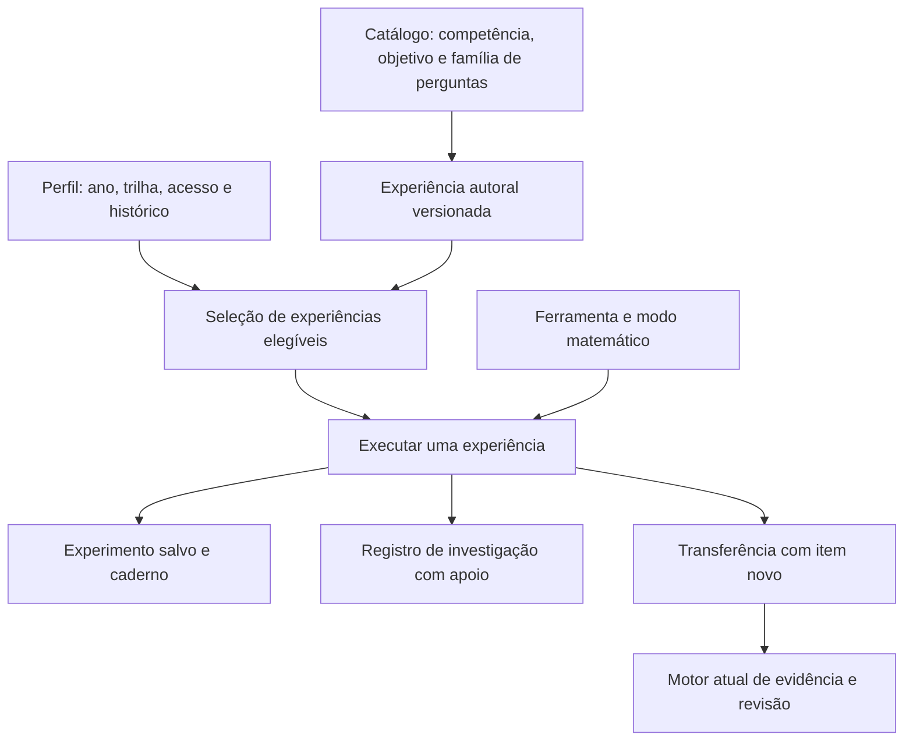

**Notas técnicas da proposta de laboratório — Missão Saber**

Referência: catálogo no commit `718f3e4`, examinado em 03/10/2026. Estas são decisões propostas; não houve alteração do aplicativo ou do banco de produção nesta pesquisa.

**A mudança principal é separar ferramenta, experiência autoral e execução do aluno.**

Hoje `bars | grid | groups` aparece em `Lesson.lab`, `Item.exploration`, `DeepChallenge.lab`, no schema de estado salvo e no tipo da coluna `experiments.kind`. A página instancia três componentes diretamente; a fábrica de conteúdo atribui `pack.lab` a todas as missões do pacote. Expandir somente esse enum repetiria a associação genérica e tornaria a página cada vez maior.

Proponho um registro tipado e versionado de ferramentas e experiências. Componentes comuns de peças, reta numérica, plano, tabela, árvore e controles numéricos podem ser compartilhados. Cada modo declara suas próprias restrições matemáticas e semântica de interação. Um componente de gráfico não substitui automaticamente uma ferramenta de semelhança; compartilhar desenho não significa compartilhar o objetivo.

**Contratos propostos.**

| Entidade | Dados relevantes |
| --- | --- |
| Definição de ferramenta | ID estável, modos suportados, schema de configuração, schema/versionamento de estado, operações válidas, renderizador, representação textual acessível e carregamento sob demanda. |
| Experiência autoral | ID/versão, competência, objetivos de missão, famílias de perguntas, anos e trilhas elegíveis, modo, configuração inicial, limites, etapas, previsão, devolutivas, critérios de solução, rubrica e variante de transferência. |
| Vínculo com pergunta | ID/versão da experiência, papel da interação, parâmetros públicos, motivo da recomendação e contexto seguro de retorno. O papel distingue representação da pergunta, exploração e apoio à resolução. |
| Execução do aluno | ID, dono/perfil, experiência/versão, montagem, etapa, previsão, observação, explicação, assistência utilizada, revisão concorrente e datas. |
| Descoberta no caderno | Referência à execução e snapshot legível da descoberta, permitindo reabrir ou duplicar uma tentativa. |
| Evento de aprendizagem | Abertura, previsão, tentativa, pista, conferência, conclusão guiada e transferência, com origem, versão e chave de idempotência. Não registrar cada movimento do mouse. |

A seleção combina o ano exato, a trilha resolvida, o acesso vigente, o estado de publicação e o objetivo. Pré-requisitos de retomada precisam ser declarados e adaptados para a faixa. A propriedade do perfil e a elegibilidade são verificadas no servidor em leitura, execução e gravação.

As matrizes entregues registram os anos em que a competência aparece em pelo menos uma trilha. Isso é um inventário de uso, não uma autorização para todas as trilhas daqueles anos. A relação `courses[].grades` no JSON preserva os pares necessários à seleção.

**Precisão matemática e validação.**

1. Configurações e estados recebidos do navegador passam por validação na fronteira. Uma montagem não pode conter peças inexistentes, coordenadas inválidas, unidades incompatíveis ou parâmetros fora do modo publicado.
2. Critérios de solução são condições matemáticas do estado, separados da renderização. Uma figura válida não precisa coincidir pixel a pixel com o exemplo do autor. Diferenciar igualdade, equivalência, congruência, semelhança e aproximação.
3. Frações usam representação racional exata quando possível. Grandezas incluem unidade e dimensão. Valores monetários e arredondamento seguem contrato por etapa; a formatação visual não pode mudar o resultado aceito.
4. Funções e expressões usam uma gramática matemática delimitada, com domínio e operações permitidas. Não executar texto de expressão como JavaScript. Reconhecer denominadores nulos, restrições de raízes/logaritmos, soluções estranhas e intervalos abertos/fechados.
5. Provas abertas têm rubrica; não atribuir validade universal a uma lista finita de exemplos. Um verificador de passos deve suportar apenas regras formalizadas e explicar seus limites.
6. Simulações probabilísticas têm modelo explícito e resultados reprodutíveis em testes. Frequência amostral não é o critério exato de uma probabilidade teórica. Não reprovar uma amostra válida por ela divergir do valor esperado.
7. Geometria preserva escala de medidas e relações impostas. Cortes, vistas, planificações e perspectiva exigem casos de referência. Grades de tela e tolerâncias de arraste não devem alterar uma resposta matemática.
8. Finanças vincula taxa e período, momento dos aportes, regime de capitalização, custos e inflação às premissas do roteiro. Os exemplos usam valores didáticos; não dependem de cotações, taxas ou legislação atualizadas para funcionar.

**Conteúdo público e avaliação.**

O payload de uma missão deve continuar preservando soluções e devolutivas reservadas. Metadados de exploração não podem transportar gabaritos de avaliações. Se uma etapa for corrigida para produzir evidência, o servidor recalcula o resultado a partir de uma versão conhecida da experiência e registra a assistência usada; não confia no booleano de acerto enviado pelo navegador.

Nos modos de descoberta e prática guiada, medições e feedback podem ser imediatos. No desafio de transferência, o roteiro controla o que está visível. Uma representação fornecida pela pergunta não é automaticamente uma pista; uma operação que entrega sua solução precisa ser registrada como apoio. A classificação é explícita no conteúdo.

O motor atual (`learning/engine.ts`) considera a primeira tentativa de um item, ajuda, famílias distintas e dias distintos para autonomia. Inicialmente, novos registros de investigação ficam separados. Uma transferência contribui por um item novo, corrigido pelo mesmo fluxo de evidência atual. Repetir a tarefa depois de ver a solução não a converte em evidência independente.

Os 336 itens reservados permanecem separados dos cenários de laboratório. A matriz abrange conceitos das avaliações por competência, sem disponibilizar os próprios itens como tutoria. Se futuramente houver avaliação com manipulação, será um contrato de item específico e revisado.

**Migração dos experimentos existentes.**

O armazenamento atual é JSON com `kind` e revisão, associado a `profileId`; a unicidade é `(profileId, kind)`. Ele já protege a propriedade do perfil, implementa revisão concorrente e permite repetição idempotente de uma gravação confirmada. Essas garantias devem ser mantidas.

Proponho criar execuções por ID de experiência e ID de tentativa, com versão explícita. A migração deve preservar integralmente as montagens e anotações antigas. Mapear barras de descontos para um modo de L03, malha de área para L05 e grupos/gavetas para L12. A nova biblioteca oferece “Meus experimentos anteriores”, dentro das regras de acesso apropriadas; se uma montagem antiga não for elegível para a faixa atual, preservar o histórico para o responsável e oferecer ao aluno uma retomada adequada.

Usar migração aditiva, leitura compatível, conversão idempotente e conferência de quantidades antes de aposentar o contrato antigo. A coluna `kind` é texto com tipagem no schema, não um enum SQL nativo; as alterações de índices, versões e relações ainda exigem migração real. A decisão entre nova tabela e evolução da tabela existente deve ser fechada no desenho técnico com o fluxo de caderno e retenção.

Sessões de aprendizagem existentes têm snapshots e o catálogo utiliza versões e hashes de revisão. Adicionar ou mudar parâmetros de exploração precisa seguir esse processo de autoria. Não recomputar gabaritos de sessões antigas nem alterar hashes somente para fazer uma verificação passar.

**Persistência e integração.**

Salvar uma execução identificada permite continuar a mesma investigação na página, dentro da missão e a partir do caderno. Uma investigação nova cria outra execução. O retorno à missão mantém item, tentativa e resposta digitada, sem pular etapas.

O salvamento automático pode agrupar alterações para evitar gravar cada movimento, mas precisa indicar pendência e confirmar a versão persistida. Antes de trocar perfil ou contexto, tratar a gravação pendente. Rascunhos locais devem ser separados por conta, perfil, experiência e versão, com limpeza no encerramento da sessão e tratamento explícito de conflito. Não prometer edição offline completa sem implementá-la e testá-la.

O servidor mantém idempotência e controle de revisão. Em duas abas, a segunda versão deve oferecer recuperação ou duplicação quando houver conflito. Montagens grandes precisam de limites de tamanho e cardinalidade; anexos ao caderno devem referenciar versões estáveis, evitando duplicação irrestrita de imagens.

**Interface, desempenho e dependências.**

Carregar apenas a ferramenta aberta. Usar HTML/SVG para controles, objetos e diagramas quando forem suficientes; os gráficos e sólidos mais complexos devem ser isolados e carregados sob demanda. O relatório acessível da montagem precisa existir independentemente da tecnologia de desenho.

Reutilizar os componentes visuais e a leitura em voz alta do app. O teclado matemático deve ser incremental: fração e decimal nos modos que precisam deles; raízes, potências e outros símbolos apenas quando fizerem parte da tarefa. A digitação comum continua disponível.

As famílias podem compartilhar geometria, frações, unidades e representação de estado. Recomendo decidir bibliotecas de gráfico, expressões e 3D a partir dos pilotos e de seus requisitos de acessibilidade/licença/manutenção. A proposta não pressupõe incorporar o código, as imagens ou os enunciados do Brilliant, nem embutir páginas externas autenticadas no produto.

Uma eventual tutoria com IA deve receber somente contexto necessário, operar sob as regras do roteiro e não substituir o verificador matemático. O lançamento inicial pode funcionar com pistas autorais e casos validados.

**Verificações relevantes para a implementação.**

| Camada | Evidência necessária |
| --- | --- |
| Catálogo | IDs válidos, modos existentes, anos/trilhas coerentes, todos os objetivos com roteiro, famílias de ensino vinculadas e ausência de gabaritos reservados no payload. |
| Matemática | Casos exatos, equivalências, contraexemplos, limites, soluções múltiplas, impossibilidades, precisão/unidades e consistência entre desenho e valores. |
| Servidor | Isolamento por conta/perfil, restrições de acesso, idempotência, concorrência, versões e migração preservando montagens antigas. |
| Navegação | Pergunta → laboratório → caderno → pergunta; recarregar, trocar perfil, abrir link direto e recuperar montagem. |
| Acessibilidade | Operar sem arrastar, foco visível, ordem de leitura, nome/estado de controles, anúncio de mudanças sem excesso, zoom, contraste e alternativa a cor/movimento. |
| Aprendizagem | Alunos da faixa interpretam a tarefa, manipulam com propósito e resolvem uma transferência nova; observar onde precisam de ajuda. |

Uma ferramenta só atende a uma competência depois de seus modos e roteiros passarem por essas verificações. Os CSVs são o ponto de partida rastreável dessa revisão.
